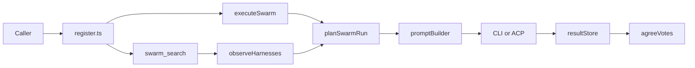

# synthet-agent-swarm design

As-built description of the server in this repository. Field-level tool JSON lives in [api.md](api.md). Image-scoring history lives in [judges-swarm.md](judges-swarm.md). ACP research lives in [acp-harness-matrix.md](acp-harness-matrix.md).

## Role

`synthet-agent-swarm` is a local stdio MCP server, version `0.1.0`, plus a small CLI. The entry point is [agent-orchestrator/src/index.ts](../agent-orchestrator/src/index.ts). With no arguments, or with `mcp`, it serves tools over stdio. Any other argument list goes to the CLI.

One call runs the same read-only judgement on the harnesses that are installed and allowed. Two or more live replies produce strict-majority agreement. Votes are evidence for a later decision. Cursor remains the editor.

The server keeps writes off. It stores redacted run output under `.agent-runs/`. It leaves Jev calls, image rendering, and label-file writes to the calling project.

## Flow

`swarm_search` observes each harness and returns a catalog. `swarm_run` validates paths, plans the harnesses, builds one prompt, runs the selected harnesses in parallel, stores each reply, then computes agreement when at least two harnesses ran.

`run_judge_panel` is the same run wrapped around a frozen item manifest. The three older tool names call the same functions and return the previous JSON shape.

## Modules

| Stage | Owner |
|---|---|
| Tool registration | [agent-orchestrator/src/tools/register.ts](../agent-orchestrator/src/tools/register.ts) |
| Search | [agent-orchestrator/src/tools/swarmSearch.ts](../agent-orchestrator/src/tools/swarmSearch.ts) |
| Run | [agent-orchestrator/src/tools/executeSwarm.ts](../agent-orchestrator/src/tools/executeSwarm.ts) |
| Catalog and plan | [agent-orchestrator/src/harness/registry.ts](../agent-orchestrator/src/harness/registry.ts) |
| Help-text detection | [agent-orchestrator/src/harness/observe.ts](../agent-orchestrator/src/harness/observe.ts) |
| Prompts | [agent-orchestrator/src/services/promptBuilder.ts](../agent-orchestrator/src/services/promptBuilder.ts) |
| Agreement | [agent-orchestrator/src/services/votes.ts](../agent-orchestrator/src/services/votes.ts) |
| Manifest panel | [agent-orchestrator/src/services/panel.ts](../agent-orchestrator/src/services/panel.ts) and [agent-orchestrator/src/tools/runJudgePanel.ts](../agent-orchestrator/src/tools/runJudgePanel.ts) |
| ACP session | [agent-orchestrator/src/acp/client.ts](../agent-orchestrator/src/acp/client.ts) |
| Config and workspace root | [agent-orchestrator/src/config.ts](../agent-orchestrator/src/config.ts) |
| Path checks | [agent-orchestrator/src/services/pathSafety.ts](../agent-orchestrator/src/services/pathSafety.ts) |
| Stored output | [agent-orchestrator/src/services/resultStore.ts](../agent-orchestrator/src/services/resultStore.ts) |
| Secret redaction | [agent-orchestrator/src/services/redaction.ts](../agent-orchestrator/src/services/redaction.ts) |

Codex, Claude, and Antigravity one-shot CLIs go through [agent-orchestrator/src/runners/](../agent-orchestrator/src/runners/). Other CLI harnesses, and every ACP harness, use the generic command path in `executeSwarm`.

## Harnesses and transport

`HARNESS_SPECS` is the catalog. Detection looks for the command on `PATH` and classifies help text. Adapters are used only when that command is already installed. Observations are cached for 60 seconds per working directory.

| id | One-shot CLI | ACP, when that command is already on PATH |
|---|---|---|
| `codex` | `codex exec` with `--sandbox read-only` and `--ask-for-approval never` | `codex-acp` |
| `claude` | `claude -p` | `claude-code-acp` |
| `agy` | `agy -p`, or `--print` / `--prompt` when help shows that flag | the same binary with `acp` when help shows an ACP mode |
| `cursor` | `agent` print mode only when help shows `-p`, `--print`, or `--prompt` | `agent acp` |
| `gemini` | `gemini` print mode when the binary exists and help shows a print flag | the same binary with `acp` when help shows an ACP mode |
| `grok` | none | `grok agent stdio` |

Aliases resolve before a run:

- `antigravity` and `agy` are one harness, id `agy`.
- `agent` is `cursor`.
- `gemini` uses the `gemini` row when that binary is available. Otherwise it uses `agy`.

`transport` is `auto`, `cli`, or `acp`. `auto` picks `cli` when detection found exec or print mode, and otherwise `acp`. A requested transport that the harness does not have becomes a per-harness `transport_unavailable` skip.

Judge-mode attachments, applied only on the CLI path:

- Codex receives each image with `--image`, and `--cd` when help shows that flag.
- Claude receives `--tools Read` and `--add-dir` for evidence directories, at most eight directories.
- Antigravity receives `--add-dir` and stays on its non-interactive prompt flag.

An ACP session answers `session/request_permission` with `outcome: cancelled`. The harness stderr then records how many requests were denied. A failed handshake is `acp_protocol` on that harness and the other harnesses continue.

## Planning

`planSwarmRun` turns the catalog into steps.

Omit `harnesses` to run every allowed harness that has the resolved transport. An empty result is `harness_unavailable` for the whole call. Duplicate ids are dropped.

`unknown_harness` fails the whole call before any spawn. So does `model_unsupported`: a `model` value is sent only when every selected runnable harness advertises `--model` in its help text. Codex inserts `--model` before the prompt. Other harnesses insert it after the binary.

A named harness that is missing, disallowed, or lacking the requested transport is a skip row. The other harnesses still run. `ok` is true when at least one harness succeeds. On a dry run, `ok` is true only when every selected harness can be previewed, and no process is spawned.

## Modes and evidence

The default mode is `review`. Modes are `review`, `implement`, `explain`, `test`, `tie-breaker`, and `judge`. `executeSwarm` sets `allowWrites` to false for every mode, so the prompt stays review-only even when the mode is `implement`.

`review` and the other non-judge modes capture a workspace snapshot: branch, short status, diff stat, file diffs, and excerpts up to 16 KiB. The prompt asks for a verdict, findings tagged `blocker | high | medium | low | nit`, suggested changes, risks, and a patch summary.

`judge` uses an empty snapshot. The prompt lists the task and the absolute evidence paths, tells the harness how to open them, and asks for the format the task requested. Blind judge panels also reject `extraContext`.

Listed paths must stay inside the workspace root (`WORKSPACE_ROOT`, or the process working directory). Secret names (`.env`, `secrets.json`, `credentials.json`, private keys, and similar) are refused. Non-judge modes also refuse binaries. Judge mode allows `.png`, `.jpg`, `.jpeg`, `.gif`, and `.webp` and still refuses other binaries. A bad path is `path_rejected` and nothing starts.

## Agreement

Agreement is computed only when the run is live and at least two harnesses have a transport. A single harness, a dry run, and a skipped row omit it. Stdout is dropped from the MCP payload after agreement is computed. The stored `swarm.json` also omits stdout; each harness directory keeps `stdout.md`.

The parser takes the last balanced JSON object in each reply, preferring one that contains an `images` array. Each `images` row is one item, identified by `id`, `image_id`, or `key`. Any other JSON object becomes a single `_reply` item. String, number, and boolean fields are votes. Identifier keys are not fields. A reply with no such object is listed in `unparsedAgents`.

A field is agreed when one value has at least two votes and strictly more votes than the next value. Ties and single votes stay disputed, with `value: null`. The agreement note states that agent-panel labels are evidence.

## Panel

`run_judge_panel` validates a frozen manifest, then calls the same swarm in `judge` mode.

- One to twenty items. Each id matches `^[A-Za-z0-9][A-Za-z0-9._-]{0,199}$` and ids are unique.
- Each item has one to twenty files. The union of files is at most twenty.
- The task plus the item-id contract must stay within 8000 characters. The contract asks for one JSON object with an `images` array whose rows use those ids.
- `blind` defaults to true. A blind panel rejects `extraContext`.
- Omit `harnesses` and `agents` to run `codex`, `agy`, and `claude`, still filtered by `allowedAgents` and availability. The legacy `agents` list accepts `codex`, `antigravity`, and `claude`.

The response has six stages:

| Stage | What it contains |
|---|---|
| `build` | Blind flag, rubric, item ids, and evidence paths |
| `run` | Per-judge rows in the legacy shape |
| `votes` | The agreement object, or an empty agreement on a dry run |
| `jev` | `called: false`, `dryRunRequired: true`, and a text-only `state` for the caller's own `jev_system_one` call |
| `analyze` | Cohen's kappa against `humanLabels` when those labels were passed and the run was live. Otherwise skipped. Disagreements cap at 50. |
| `rules` | `applied: false`. Keep, cull, delete, and rating writes stay in the calling project. |

A panel summary is stored at `.agent-runs/<timestamp>-panel-<slug>/panel.json`.

## Persistence and config

Each harness writes `.agent-runs/<timestamp>-<id>-<slug>/` with `stdout.md`, `stderr.log`, `request.json`, and `result.json`. The swarm summary is `.agent-runs/<timestamp>-swarm-<slug>/swarm.json`. Slugs are lowercase, at most 40 characters. Stored text passes through redaction for common key, token, bearer, and private-key shapes. Prompts are stored only when `storePrompts` is true. The default is false. `storeOutputs: false` skips all of these files.

Config merges in this order: code defaults, [agent-orchestrator/config.default.json](../agent-orchestrator/config.default.json), then `.agent-orchestrator.json` in the workspace root. A workspace `allowedAgents` list replaces the default. `antigravity` and `agy` count as the same harness, and `agent` counts as `cursor`. A file that names only `codex`, `antigravity`, and `claude` leaves out `cursor`, `gemini`, and `grok`.

Timeouts clamp to at least 1 second and at most `maxTimeoutMs`. The defaults are 300 seconds and 900 seconds. Detection uses `detectionTimeoutMs`, default 10 seconds. `codex.jsonOutput` adds `--json` only when that flag appears in Codex help. The default is false.

## Compatibility

| Surface | Behavior |
|---|---|
| `detect_subagents` | Legacy detection records for Codex, Antigravity, and Claude |
| `run_subagent` | One of those three, read-only, previous JSON shape |
| `run_judge_swarm` | Same judgement and agreement, previous JSON shape. `antigravity` in the response is the `agy` harness |
| CLI `detect` | Prints the `swarm_search` catalog |
| CLI `run` | One legacy agent |
| CLI `swarm` | Legacy judge wrapper. New callers use `swarm_search` and `swarm_run` |

Tool annotations mark every tool read-only. Error codes are `unknown_harness`, `harness_unavailable`, `model_unsupported`, `transport_unavailable`, `path_rejected`, `timeout`, `acp_protocol`, and `invalid_arguments`. Shapes and retry flags are in [api.md](api.md).

Reload MCP after a rebuild so hosts pick up tool changes.
